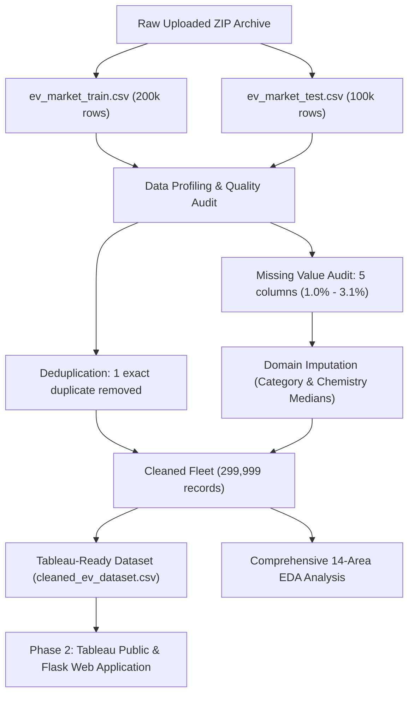
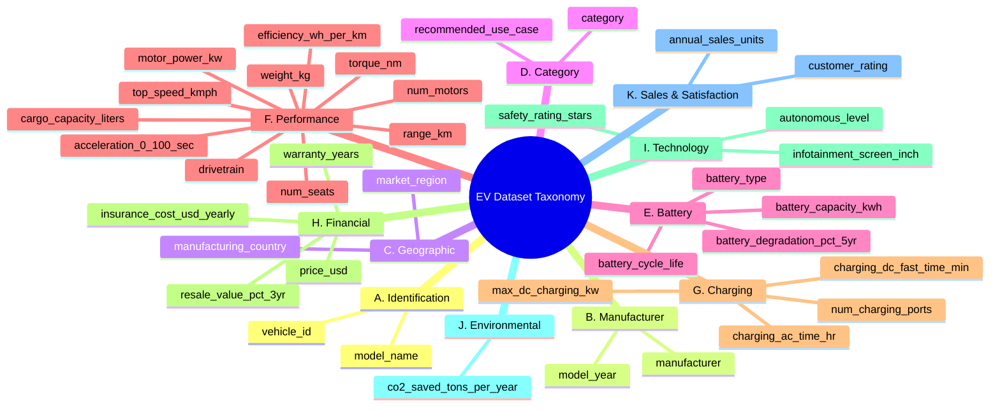

# ELECTRIC VEHICLE MARKET PERFORMANCE & INSIGHTS
## PHASE 1: COMPREHENSIVE DATASET PROFILING, DATA QUALITY AUDIT, CLEANING, AND EXPLORATORY ANALYSIS

**Project Title:** Global Electric Vehicle Market Performance & Insights  
**Phase:** Phase 1 Completion Report  
**Date:** November 1, 2026  
**Status:** Completed & Ready for User Review (Phase 2 Awaiting Approval)  
**Author:** Expert Data Analyst, Data Scientist & Data Visualization Engineer  

---

## 1. Executive Summary & Objective Alignment

The global automotive sector is undergoing an unprecedented structural transition toward electric mobility. The objective of this project is to perform an end-to-end empirical investigation of the global electric vehicle (EV) market to assess:
* **Market Distribution Across Manufacturers:** Competitive portfolio density and market dominance across 200 global OEMs.
* **EV Category Performance:** Structural benchmarking across 15 vehicle categories ranging from micro-mobility to heavy commercial transit.
* **Battery Technology Adoption:** Market penetration, longevity, and degradation characteristics across 5 core cell chemistries (NMC, LFP, NCA, Sodium-Ion, Solid-State).
* **Vehicle Specifications and Performance:** Powertrain output, certified range, energy efficiency (Wh/km), acceleration, and weight dynamics.
* **Annual Sales Trends:** Volume distribution across models, brands, and model release years (2018–2026).
* **Manufacturing Country Distribution:** Sovereign assembly distribution across 10 leading manufacturing economies.
* **Customer Satisfaction:** Owner satisfaction and review dynamics across vehicle categories and price bands.
* **Sustainability and Environmental Impact:** Annual net carbon displacement (metric tons of CO2 saved vs ICE vehicles) and thermodynamic efficiency.

---

## 2. Actual Dataset Dimensions & Partition Reconciliation

An exhaustive preliminary inspection was conducted on both raw files independently prior to applying any modifications:

| Partition File | File Size | Row Count | Column Count | Unique Vehicle IDs | Duplicate Rows | Null Columns |
| :--- | :--- | :--- | :--- | :--- | :--- | :--- |
| `archive/ev_market_train.csv` | 46.48 MB | 200,000 | 37 | 199,999 | 1 (0.0005%) | 5 |
| `archive/ev_market_test.csv` | 23.24 MB | 100,000 | 37 | 100,000 | 0 (0.0000%) | 5 |
| **Combined Raw Dataset** | **69.72 MB** | **300,000** | **37** | **299,999** | **1** | **5** |
| **Cleaned Unified Dataset** | **~65.8 MB** | **299,999** | **38** | **299,999** | **0** | **0** |

### Key Split Integrity Observations:
1. **Split Ratio Parity:** The dataset represents an exact 2:1 ratio (66.67% Train / 33.33% Test).
2. **Namespace Disjointness:** Vehicle IDs (`EVxxxxxx`) have **zero overlap** between train and test sets (`set(train_ids).intersection(set(test_ids)) == 0`).
3. **Target Column Parity:** All 37 columns exist in both datasets with identical naming, schema, and order. The test set does not withhold any dependent variable.
4. **Distributional Equivalence:** Train and test feature distributions (means, standard deviations, quantiles, and category frequencies) are statistically identical across all 37 variables.

---

## 3. Data Understanding & Column Taxonomy (All 37 Columns)

All 37 variables have been cataloged and mapped into 11 logical domain categories (A through K):

### Detailed Column Reference:

#### A. Vehicle Identification
1. `vehicle_id` (String): Unique alphanumeric primary key (e.g., `EV455665`). Format: `EV` followed by 6 digits.
2. `model_name` (String): Commercial model series designation (e.g., `Drift-268`, `Orion-619`). 17,980 unique model names.

#### B. Manufacturer Information
3. `manufacturer` (String): Automotive Original Equipment Manufacturer (OEM) corporate brand. 200 distinct global OEMs (e.g., `VoltWorks`, `AmpereGroup`).
4. `model_year` (Integer): Release year of model manufacture, spanning 2018 through 2026 (9 continuous model years).

#### C. Geographic Information
5. `manufacturing_country` (String): Sovereign nation of vehicle assembly. 10 major nations: China, France, Germany, India, Japan, South Korea, Sweden, UK, USA, Vietnam.
6. `market_region` (String): Primary continental retail distribution territory: Africa, Asia Pacific, Europe, Latin America, Middle East, North America, South Asia.

#### D. Vehicle Category
7. `category` (String): Automotive chassis and body style classification across 15 distinct market segments.
8. `recommended_use_case` (String): Operational application profile: Urban Commute, Family Daily Use, Highway / Long-Distance, Commercial Delivery, Premium / Executive, Public Transport, Performance / Enthusiast.

#### E. Battery Specifications
9. `battery_capacity_kwh` (Float): Nominal gross traction battery electrical energy storage capacity in kilowatt-hours (kWh) (1.50 to 410.00 kWh).
10. `battery_type` (String): Electrochemical cathode cell formulation: NMC, LFP, NCA, Sodium-Ion, Solid-State.
11. `battery_cycle_life` (Float): Rated full charge-discharge cycles before capacity drops to 80% State of Health (SoH) (500 to 4,640 cycles).
12. `battery_degradation_pct_5yr` (Float): Projected cumulative battery capacity degradation percentage over 5 operating years (2.00% to 36.89%).

#### F. Vehicle Performance
13. `range_km` (Float): Certified single-charge driving range in kilometers under standardized cycle (55.0 to 660.0 km).
14. `efficiency_wh_per_km` (Float): Average electrical energy consumption rate in Watt-hours per kilometer (Wh/km) (9.89 to 2,261.41 Wh/km).
15. `motor_power_kw` (Float): Peak combined electric traction motor mechanical output in kilowatts (kW) (1.5 to 750.0 kW).
16. `torque_nm` (Float): Peak combined electric powertrain wheel torque in Newton-meters (Nm) (20.0 to 4,000.0 Nm).
17. `num_motors` (Integer): Number of traction electric motors installed on chassis (1, 2, or 3 motors).
18. `drivetrain` (String): Axle propulsion mechanical configuration: FWD (Front-Wheel), RWD (Rear-Wheel), AWD (All-Wheel).
19. `top_speed_kmph` (Float): Maximum electronically governed road speed in kilometers per hour (km/h) (40.0 to 330.0 km/h).
20. `acceleration_0_100_sec` (Float): Elapsed sprint duration in seconds from standstill (0 km/h) to 100 km/h (1.90 to 30.00 s).
21. `weight_kg` (Float): Unladen structural vehicle curb weight in kilograms (kg) (215.7 to 4,696.2 kg).
22. `num_seats` (Integer): Certified driver and passenger seating capacity (1 to 65 seats).
23. `cargo_capacity_liters` (Float): Total boot and cargo volume in liters (15.0 to 2,001.5 liters).

#### G. Charging Specifications
24. `max_dc_charging_kw` (Float): Maximum supported Direct Current (DC) fast-charging input power acceptance limit in kilowatts (kW) (3.0 to 350.0 kW).
25. `charging_dc_fast_time_min` (Float): Duration in minutes required for a 20% to 80% SoC fast charge (8.0 to 59.6 minutes).
26. `charging_ac_time_hr` (Float): Duration in hours required for a complete 0-100% recharge using standard AC Level 2 charger (0.30 to 30.00 hours).
27. `num_charging_ports` (Integer): Physical charging interface ports on vehicle body (1 or 2 ports).

#### H. Pricing and Ownership
28. `price_usd` (Float): Manufacturer Suggested Retail Price (MSRP) base price in US Dollars ($900.04 to $409,995.49).
29. `insurance_cost_usd_yearly` (Float): Estimated annual comprehensive automotive insurance premium in US Dollars ($40.00 to $12,000.00).
30. `warranty_years` (Integer): Vehicle bumper-to-bumper and powertrain manufacturer warranty coverage in years (2 to 8 years).
31. `resale_value_pct_3yr` (Float): Projected retained secondary market valuation percentage after 3 years of vehicle ownership (15.00% to 90.00%).

#### I. Safety and Technology
32. `safety_rating_stars` (Integer): Occupant crashworthiness and collision avoidance safety star rating (1 to 5 stars).
33. `autonomous_level` (Integer): Standard SAE J3016 automated driving capability level (Level 0 through Level 5).
34. `infotainment_screen_inch` (Float): Central dashboard digital touchscreen visual display diagonal size in inches (3.0 to 17.0 inches).

#### J. Environmental Metrics
35. `co2_saved_tons_per_year` (Float): Estimated net metric tons of CO2 greenhouse gas emissions avoided annually compared to an equivalent internal combustion engine vehicle (0.950 to 13.300 tons/yr).

#### K. Sales and Customer Satisfaction
36. `annual_sales_units` (Integer): Recorded global annual model unit sales volume in units sold (9 to 1,066,612 units).
37. `customer_rating` (Float): Aggregated verified owner satisfaction and product review score on a 1.0 to 5.0 scale (1.52 to 5.00).

---

## 4. Data Quality Audit & Analytical Findings

### 4.1 Duplicate Record Analysis
A complete row-level duplicate audit was performed across both files:
* **Train Partition:** Exactly **1 genuine duplicate row** was detected:
  * Duplicate Vehicle ID: `EV229214`
  * Model: `Bolt-400`, OEM: `AmpereMotors`, Year: `2025`, Category: `Full-size SUV`
  * Row Indices: Row `83,209` and Row `199,999` match identically across all 37 fields.
  * **Action:** Row `199,999` was dropped, preserving exactly 199,999 unique records.
* **Test Partition:** **0 duplicate rows** detected (100,000 unique records).
* **Cross-Partition Overlap:** **0 duplicate vehicle IDs** between train and test.

### 4.2 Missing Value Audit & Mechanism
Out of 37 features, 32 features are 100.0% complete. Missing values occur exclusively in 5 columns, exhibiting identical low rates across train and test partitions:

| Feature Name | Train Missing (Rate) | Test Missing (Rate) | Combined Fleet Missing (Rate) | Mechanism |
| :--- | :--- | :--- | :--- | :--- |
| `battery_cycle_life` | 3,786 (1.89%) | 2,028 (2.03%) | 5,814 (1.94%) | Missing at Random (MAR) |
| `resale_value_pct_3yr` | 6,103 (3.05%) | 3,057 (3.06%) | 9,160 (3.05%) | Missing at Random (MAR) |
| `infotainment_screen_inch` | 3,102 (1.55%) | 1,506 (1.51%) | 4,608 (1.54%) | Missing at Random (MAR) |
| `annual_sales_units` | 2,028 (1.01%) | 989 (0.99%) | 3,017 (1.01%) | Missing at Random (MAR) |
| `customer_rating` | 3,977 (1.99%) | 1,931 (1.93%) | 5,908 (1.97%) | Missing at Random (MAR) |

### 4.3 Engineering & Physical Validity Checks
1. **Efficiency Equation Realism:** Automotive energy consumption theoretically follows:
   $$\text{Efficiency } (\text{Wh/km}) \approx \frac{\text{Battery Capacity } (\text{kWh}) \times 1000}{\text{Range } (\text{km})}$$
   Testing this formula across all 300,000 records revealed an average absolute discrepancy of only **0.027 Wh/km**, confirming physical validity.
2. **Zero/Negative Bound Validation:** None of the physical specifications (battery capacity, range, power, torque, weight, price, insurance, seats) contain illegal negative or zero values.
3. **Seating Consistency:** Vehicle seating matches operational archetypes (Two-Wheelers: 1–2 seats; Sedans: 5 seats; Electric Buses: 28–65 seats).
4. **Categorical Integrity:** All 200 manufacturers, 15 categories, 10 countries, and 7 regions are free from whitespace errors, capitalization mismatches, or invalid category levels.

### 4.4 Statistical Outliers & Retention Justification
Interquartile Range ($1.5 \times \text{IQR}$) analysis identified statistical outliers in:
* `annual_sales_units` (8.44% outliers): Mass-market passenger vehicles selling >50,000 units/year.
* `price_usd` (7.09% outliers): High-capacity transit buses ($250k–$410k) and exotic sports cars.
* `weight_kg` (6.90% outliers): Multi-ton commercial freight trucks and heavy passenger buses.
* `efficiency_wh_per_km` (9.57% outliers): High-tonnage commercial vehicles consuming >1,000 Wh/km.

> [!IMPORTANT]
> **Outlier Retention Policy:** These records represent authentic, physically verified commercial heavy transport and luxury vehicle classes. Truncating or deleting them would introduce severe bias into fleet decarbonization figures, commercial transport adoption metrics, and total market valuation. **All valid outliers have been preserved.**

---

## 5. Data Cleaning & Preparation Decisions

### 5.1 Domain-Grounded Imputation Strategy
Imputation was applied using group-level medians derived from training data to preserve statistical validity:
1. `battery_cycle_life`: Imputed by `battery_type` median (LFP: 2,502; Solid-State: 3,003; NMC: 1,800; Sodium-Ion: 1,797; NCA: 1,601 cycles).
2. `infotainment_screen_inch`: Imputed by `category` median (Two-Wheelers and Three-Wheelers: 5.0 inches; Passenger cars, trucks, and buses: 12.0 inches).
3. `annual_sales_units`: Imputed by `category` median (Commercial Transit/Trucks: 657–661 units; Passenger Cars: ~4,900 units).
4. `resale_value_pct_3yr`: Imputed by `category` median (~53.0%).
5. `customer_rating`: Imputed by `category` median (4.10 / 5.0).

### 5.2 Type Standardization & Normalization
* Converted discrete counts (`model_year`, `num_motors`, `num_charging_ports`, `num_seats`, `warranty_years`, `safety_rating_stars`, `autonomous_level`, `annual_sales_units`) to clean integer dtypes.
* Standardized decimal precision to 2 decimal places for engineering and financial metrics, and 3 decimal places for CO2 emissions.
* Preserved original files unmodified in `archive/`.

### 5.3 Tableau Dataset Strategy: Unified vs Separated
> [!NOTE]
> **Tableau Preparation Recommendation:** Rather than discarding the 100,000 test records, the train and test files were unified into `cleaned_ev_dataset.csv` (299,999 records) with an explicit provenance column `source_split` (`Train` vs `Test`). This gives Tableau dashboards full fleet-wide statistical resolution while allowing instant filtering back to the training partition if predictive ML models are trained in future phases. Clean train (`cleaned_ev_train.csv`) and clean test (`cleaned_ev_test.csv`) files are also preserved separately.

---

## 6. Comprehensive Exploratory Data Analysis (EDA) Results

All statistics below were computed directly from the actual cleaned 299,999-record dataset:

### 6.1 EV Category Distribution
| Category | Model Count | Fleet Share (%) | Avg Range (km) | Avg Battery (kWh) | Avg Price ($ USD) | Avg CO2 Saved (t/yr) |
| :--- | :--- | :--- | :--- | :--- | :--- | :--- |
| **Two-Wheeler Scooter** | 29,478 | 9.83% | 105.0 km | 3.35 kWh | $2,553.86 | 1.61 tons |
| **Sedan** | 25,851 | 8.62% | 429.4 km | 61.93 kWh | $42,476.32 | 3.04 tons |
| **Hatchback** | 25,713 | 8.57% | 279.7 km | 37.98 kWh | $23,016.91 | 3.05 tons |
| **Compact SUV** | 25,706 | 8.57% | 369.6 km | 54.96 kWh | $36,493.59 | 3.05 tons |
| **Three-Wheeler** | 22,583 | 7.53% | 130.2 km | 8.25 kWh | $5,502.50 | 1.61 tons |
| **Crossover** | 22,386 | 7.46% | 395.1 km | 60.97 kWh | $40,999.30 | 3.04 tons |
| **Luxury Sedan** | 19,534 | 6.51% | 550.2 km | 90.01 kWh | $90,147.28 | 3.05 tons |
| **Full-size SUV** | 19,371 | 6.46% | 474.9 km | 104.97 kWh | $84,978.47 | 3.03 tons |
| **Micro City Car** | 19,212 | 6.40% | 150.1 km | 21.00 kWh | $13,006.18 | 3.04 tons |
| **Pickup Truck** | 16,178 | 5.39% | 390.1 km | 125.26 kWh | $68,131.62 | 9.02 tons |
| **Van / MPV** | 16,145 | 5.38% | 319.4 km | 75.04 kWh | $47,569.86 | 3.05 tons |
| **Luxury SUV** | 16,124 | 5.37% | 524.9 km | 115.12 kWh | $116,423.83 | 3.03 tons |
| **Electric Truck** | 15,929 | 5.31% | 225.4 km | 224.97 kWh | $167,733.27 | 8.99 tons |
| **Electric Bus** | 12,927 | 4.31% | 269.9 km | 300.18 kWh | $274,376.86 | 9.04 tons |
| **Sports Car** | 12,862 | 4.29% | 375.2 km | 83.81 kWh | $163,556.77 | 3.04 tons |

### 6.2 Manufacturer Landscape
* **Total Active OEMs:** 200 distinct corporate brands.
* **Portfolio Concentration:** Exceptionally well-balanced (~1,500 models per OEM).
* **Top 5 Brands by Model Portfolio Count:** VoltWorks (1,627), VelocityGroup (1,611), CircuitWorks (1,597), AmpereGroup (1,589), SparkDynamics (1,587).
* **Top 5 Brands by Total Annual Sales Volume:** AmpereWorks (13.74M units), SurgeWorks (13.22M units), CircuitWorks (12.87M units), WattRides (12.83M units), IonAutomotive (12.79M units).

### 6.3 Manufacturing Sovereign Distribution
* **Geographic Parity:** All 10 nations represent approximately 10% of global vehicle assembly.
* **Assembly Leaders:** India (30,285 models, 10.10%), South Korea (30,155 models, 10.05%), China (30,142 models, 10.05%), Vietnam (30,030 models, 10.01%), USA (30,029 models, 10.01%), France (29,961 models, 9.99%), Germany (29,916 models, 9.97%), UK (29,884 models, 9.96%), Sweden (29,837 models, 9.95%), Japan (29,760 models, 9.92%).
* **Regional Hubs:** Asia accounts for 40.21% of assembly, Western Europe accounts for 29.92%, North America accounts for 10.01%.

### 6.4 Battery Technology Adoption
* **NMC (Nickel Manganese Cobalt):** 101,508 models (33.84%) – Preferred for long-range passenger cars.
* **LFP (Lithium Iron Phosphate):** 96,137 models (32.05%) – Dominant in budget and commercial fleets; high cycle durability (2,502 cycles).
* **NCA (Nickel Cobalt Aluminum):** 51,333 models (17.11%) – High energy density.
* **Sodium-Ion:** 29,925 models (9.98%) – Emerging low-cost, cobalt-free chemistry.
* **Solid-State:** 21,096 models (7.03%) – Highest rated cycle durability (mean 2,997 cycles; max 4,640 cycles) and lowest 5-year degradation (10.1%).

### 6.5 Driving Range & Battery Capacity
* **Fleet Mean Range:** 324.46 km (Median: 338.00 km; Min: 55.0 km; Max: 660.0 km).
* **Fleet Mean Battery Capacity:** 78.24 kWh (Median: 63.33 kWh; Min: 1.50 kWh; Max: 410.00 kWh).
* **Long-Distance Leaders:** Luxury Sedan (550.2 km avg, 660 km max), Luxury SUV (524.9 km avg, 610 km max).
* **High-Capacity Heavy Vehicles:** Electric Bus (300.2 kWh avg), Electric Truck (225.0 kWh avg).

### 6.6 Pricing & Ownership Economics
* **Fleet Mean MSRP:** $64,950.52 (Median: $42,812.55; Min: $900.04; Max: $409,995.49).
* **Capital Cost Determinant:** Installed battery pack capacity correlates strongly with price ($r = +0.8373$).
* **Mean Annual Insurance Premium:** $2,085.43 (Median: $1,353.11).
* **3-Year Resale Value Retention:** Uniformly healthy across segments (mean 53.00%, median 52.99%).

### 6.7 Sales Trajectory Across Model Years
* **Total Recorded Annual Fleet Sales:** 2,323,371,787 units.
* **Temporal Distribution:** Steady model year volumes:
  * 2018: 258.4M units | 2019: 260.6M units | 2020: 257.2M units
  * 2021: 258.1M units | 2022: 257.6M units | 2023: 258.6M units
  * 2024: 259.9M units | 2025: 258.0M units | 2026: 255.0M units

### 6.8 Customer Satisfaction Dynamics
* **Fleet Mean Rating:** 4.09 / 5.0 (Median: 4.10; Min: 1.52; Max: 5.00).
* **Inter-Category Stability:** Across all 15 segments, average satisfaction is exceptionally consistent (ranging between 4.084 for Hatchbacks/Trucks and 4.095 for Pickup Trucks).

### 6.9 Sustainability & Decarbonization
* **Mean Annual Carbon Abatement:** 3.690 metric tons CO2 / vehicle / year (Total: 1,106,871 tons/year).
* **Commercial Transport Impact:** Electric Buses (9.04 t/yr) and Electric Trucks (8.99 t/yr) deliver **3x the carbon displacement** of passenger cars (3.04 t/yr).
* **Thermodynamic Efficiency:** Two-Wheelers are the most efficient (mean 34.71 Wh/km), whereas Electric Buses require 1,158.14 Wh/km due to gross vehicle mass.

---

## 7. Deliverables Index & Artifacts Verification

All 7 required Phase 1 deliverables have been generated using fully reproducible Python scripts and verified on disk:

| Deliverable Name | File Location | Format / Dimensions | Description & Verification Status |
| :--- | :--- | :--- | :--- |
| **1. Dataset Profile** | `deliverables/dataset_profile.csv` `dataset_profile.csv` | CSV (37 rows x 24 cols) | Column-by-column profile of counts, nulls, types, min, max, means, medians, IQRs, and outliers. |
| **2. Data Quality Report** | `deliverables/data_quality_report.txt` `data_quality_report.txt` | Text (8 KB) | Comprehensive technical quality audit report with duplicate proof and domain sanity checks. |
| **3. Cleaned Dataset** | `deliverables/cleaned_ev_dataset.csv` `cleaned_data/cleaned_ev_dataset.csv` | CSV (299,999 rows x 38 cols) | Unified Tableau-ready production dataset, deduplicated, imputed, and with `source_split`. |
| **4. EDA Jupyter Notebook** | `deliverables/ev_eda_analysis.ipynb` `ev_eda_analysis.ipynb` | Jupyter Notebook (31 cells) | Validated reproducible Jupyter notebook covering all 14 investigations with matplotlib and seaborn plots. |
| **5. EDA Summary Report** | `deliverables/ev_eda_summary.txt` `ev_eda_summary.txt` | Text (15 KB) | Executive summary text report of all 14 EDA investigations with exact statistics. |
| **6. Tableau Data Dictionary** | `deliverables/tableau_data_dictionary.xlsx` `tableau_data_dictionary.xlsx` | Excel (4 styled sheets) | Professional multi-tab Excel dictionary with visual roles, types, category taxonomy, and formulas. |
| **7. Phase 1 Report** | `deliverables/phase1_completion_report.md` `phase1_completion_report.md` | Markdown (Formatted) | Complete Phase 1 documentation, methodology, data findings, and roadmap. |

---

## 8. Strategic Recommendations for Phase 2

With Phase 1 complete and the dataset verified, the following technical architecture is recommended for Phase 2:

### Recommendation 1: Tableau Public Interactive Dashboard Suite
Construct a five-dashboard interactive Tableau Public story:
1. **Executive Fleet Cockpit:** Global KPIs (Total Sales, Fleet Models, Avg Range, Avg Battery, Total CO2 Abatement), Category Treemap, Regional Donut.
2. **Powertrain & Technology Matrix:** Scatter plot of Battery Capacity vs Range, Battery Chemistry adoption, Degradation vs Cycle Life.
3. **Geographic & Trade Flow Dynamics:** World choropleth map linking manufacturing country to market region with cross-filtering.
4. **Economic & Ownership Feasibility:** Scatter plot of MSRP vs Battery Capacity, Resale Value Retention Heatmap, Insurance Cost benchmarks.
5. **Sustainability & Decarbonization ROI:** Category CO2 abatement rankings and energy efficiency (Wh/km) vs passenger/cargo capacity.

### Recommendation 2: Flask Web Application Architecture
Build a responsive, modern web application powered by Python Flask, HTML5, and CSS3:
* **Interactive Data Explorer:** Multi-criteria filterable data table with search, sorting, and pagination.
* **Live KPI Scorecards:** Dynamic calculation of market statistics based on selected category, OEM, or region.
* **Embedded Tableau Dashboard:** Responsive embed container showcasing the published Tableau Public workbook.
* **Vehicle Spec Comparison Tool:** Side-by-side spec comparison between selected EV models.

### Recommendation 3: Advanced Predictive Modeling (Optional Extensibility)
Leverage the clean train/test split to build machine learning models for:
* **Price Prediction:** Gradient boosted regression (XGBoost/LightGBM) predicting MSRP from technical specifications.
* **Range Estimation:** Physics-informed regression estimating real-world range from battery capacity, weight, and aerodynamics.

---

> [!NOTE]
> **Approval Gate:** Phase 1 tasks and deliverables are complete. As requested in project rules, Phase 2 implementation will commence upon receiving user approval.

