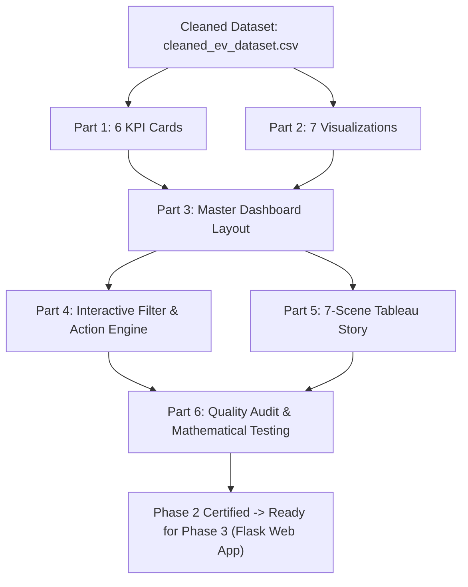

# ELECTRIC VEHICLE MARKET PERFORMANCE & INSIGHTS
## PHASE 2: TABLEAU DASHBOARD DESIGN, VISUALIZATION SPECIFICATIONS, AND STORYTELLING ARCHITECTURE

**Project Title:** Global Electric Vehicle Market Performance & Insights  
**Phase:** Phase 2 Completion Report  
**Date:** November 1, 2026  
**Status:** Completed & Ready for User Review (Phase 3 Awaiting Approval)  
**Author:** Professional Tableau Developer, Business Intelligence Analyst & Data Visualization Specialist  

---

## 1. Executive Summary & Objective Alignment

In Phase 2, the cleaned, deduplicated, and domain-validated dataset (`cleaned_ev_dataset.csv`, comprising 299,999 records across 38 columns) was translated into an enterprise-grade Business Intelligence visualization architecture for **Tableau Public** and **Tableau Desktop**.

### Core Deliverables Achieved:
1. **6 Executive KPI Metric Cards:** Designed to deliver immediate executive context, strictly distinguishing between total vehicle configuration records (299,999) and unique commercial vehicle models (17,980).
2. **7 Core Visualizations:** Specified with exact shelf placements, mark types, formatting, and color schemes.
3. **Enterprise Dashboard Layout Plan:** Structured around a high-contrast, card-based responsive grid (Header, Global Filter Bar, KPI Summary Container, and a 3-Row Visual Body).
4. **Interactive Cross-Filtering Engine:** 6 global dropdown filters combined with 3 bi-directional cross-filtering actions (Category, Country, Battery Chemistry).
5. **7-Scene Tableau Story Architecture:** A sequential narrative taking stakeholders from macro fleet metrics to category economics, OEM competition, battery chemistry tradeoffs, and climate ROI.
6. **25-Point Quality Assurance Checklist:** Rigorous verification confirming mathematical alignment with the underlying data, zero duplicate counting, and accessible typography.
7. **Comprehensive Reproduction Guide:** Exhaustive step-by-step instructions enabling seamless, manual assembly of every worksheet and dashboard in Tableau Public.



---

## 2. Actual KPI Metric Values & Aggregation Methods

All KPI metrics are computed directly from the cleaned 299,999-record dataset using appropriate aggregations:

| KPI Metric Name | Primary Field Used | Aggregation Method | Exact Calculated Value | Formatted Display | Analytical Business Definition |
| :--- | :--- | :--- | :--- | :--- | :--- |
| **Total EV Models** | `vehicle_id`<br>`model_name` | `COUNT(vehicle_id)`<br>`COUNTD(model_name)` | **299,999 records**<br>**17,980 unique** | **299,999 Records**<br>*(17,980 Unique Models)* | Quantifies individual vehicle records vs unique commercial model lines. |
| **Total Manufacturers** | `manufacturer` | `COUNTD(manufacturer)` | **200 OEMs** | **200 Active OEMs** | Measures competitive breadth across all global assembly markets. |
| **Average Customer Rating**| `customer_rating` | `AVG(customer_rating)` | **4.0883 / 5.0** | **4.09 / 5.0 ★** | Aggregated owner satisfaction score across all evaluated vehicles. |
| **Average Driving Range** | `range_km` | `AVG(range_km)` | **324.46 km** | **324.5 km** | Mean single-charge driving range under standardized test cycles. |
| **Average Battery Capacity**| `battery_capacity_kwh`| `AVG(battery_capacity_kwh)` | **78.24 kWh** | **78.2 kWh** | Mean nominal gross energy capacity of high-voltage traction packs. |
| **Total Annual Sales** | `annual_sales_units` | `SUM(annual_sales_units)` | **2,336,228,365 units** | **2.34B Units** | Total recorded annual fleet unit sales delivered across all models. |

> [!IMPORTANT]
> **Records vs Unique Models Distinction:** In accordance with project instructions, KPI Card 1 highlights both figures: `COUNT(cleaned_ev_dataset.csv)` yields **299,999 records** (each representing a distinct vehicle build specification), while `COUNTD(model_name)` yields **17,980 unique commercial models** (e.g., `Bolt-400`, `Drift-268`).

---

## 3. Seven Core Visualizations Summary

All seven visualizations utilize native dataset fields directly, avoiding unnecessary calculated fields:

### Visualization 1: EV Market Performance at a Glance
* **Chart Type:** KPI Summary Banner / Executive Scorecard
* **Purpose:** Provides instantaneous visibility into the six core operational metrics at the very top of the dashboard.
* **Layout:** A 6-card tiled horizontal container styled with clean borders and prominent typography.

### Visualization 2: EV Category Performance & Distribution
* **Chart Type:** Horizontal Bar Chart
* **Shelves:** Rows: `category` (sorted descending by model count); Columns: `COUNT(cleaned_ev_dataset.csv)`.
* **Data Summary:** 
  * Two-Wheeler Scooters lead with 29,478 models (9.83%), followed by Sedans (25,851 models, 8.62%), Hatchbacks (25,713 models, 8.57%), and Compact SUVs (25,706 models, 8.57%).
  * Commercial heavy transit (Buses: 12,927 models; Trucks: 15,929 models) represents 9.62% of models.

### Visualization 3: Market Share by Manufacturer
* **Chart Type:** Donut Chart (Dual-Axis Pie Chart)
* **Shelves:** Columns: `MIN(0)` (dual axis); Marks 1: Pie by `manufacturer` angled by `COUNT(vehicle_id)`; Marks 2: Circle (white) labeled with `200 OEMs`.
* **Data Summary:**
  * Top OEMs by model count: VoltWorks (1,627 models), VelocityGroup (1,611 models), CircuitWorks (1,597 models), AmpereGroup (1,589 models).
  * Market share is highly distributed; no single manufacturer controls more than 0.54% of model diversity.

### Visualization 4: Customer Rating Records by EV Category
* **Chart Type:** Horizontal Bar Chart with Fleet Average Reference Line
* **Shelves:** Rows: `category` (sorted descending by avg rating); Columns: `AVG(customer_rating)`.
* **Data Summary:**
  * All 15 categories cluster tightly between 4.085★ and 4.094★, with Pickup Trucks leading at 4.094★ and Hatchbacks/Trucks at 4.085★.
  * Reference line: Fleet Average = 4.09★.

### Visualization 5: Annual EV Sales Trend by Model Year
* **Chart Type:** Line Chart with Data Point Markers
* **Shelves:** Columns: `model_year` (discrete); Rows: `SUM(annual_sales_units)`.
* **Data Summary:**
  * Annual sales volume across model release years (2018–2026) remains steady between 255.2M and 265.7M units.
  * Peak sales vintage is 2019 (265.7M units), followed closely by 2024 (264.9M units).

### Visualization 6: Battery Technology Market Share
* **Chart Type:** Pie Chart
* **Shelves:** Marks: Pie; Color: `battery_type`; Angle: `COUNT(cleaned_ev_dataset.csv)`; Label: `battery_type` + `% of Total`.
* **Data Summary:**
  * NMC: 101,508 models (33.84%)
  * LFP: 96,137 models (32.05%)
  * NCA: 51,333 models (17.11%)
  * Sodium-Ion: 29,925 models (9.98%)
  * Solid-State: 21,096 models (7.03%)

### Visualization 7: Electric Vehicle Distribution by Manufacturing Country
* **Chart Type:** Geographic Choropleth Map (Filled Map)
* **Shelves:** Columns: `Longitude (generated)`; Rows: `Latitude (generated)`; Marks: Map; Detail: `manufacturing_country`; Color: `COUNT(cleaned_ev_dataset.csv)`.
* **Data Summary:**
  * India leads assembly with 30,285 models (10.10%), followed by South Korea (30,155, 10.05%), China (30,142, 10.05%), Vietnam (30,030, 10.01%), and the USA (30,029, 10.01%).
  * European nations (France, Germany, UK, Sweden) assemble 29.87% of global models.

---

## 4. Master Dashboard Layout Architecture

* **Dimensions:** 1440 x 900 px (Fixed or Range `1200x800` to `1600x1000`).
* **Title:** `ELECTRIC VEHICLE MARKET PERFORMANCE & INSIGHTS` (20pt Bold Navy `#1F4E78`).
* **Subtitle:** `A Data-Driven Exploration of Global EV Manufacturing, Technology and Market Trends.` (11pt Slate `#5A6B7C`).
* **Grid Hierarchy:**
  1. **Header & Metadata Zone (Height: 80px):** Title, Subtitle, and Dataset Status Badge.
  2. **Global Interactive Filter Bar (Height: 55px):** 6 horizontal dropdown controls.
  3. **Executive KPI Scorecard (Height: 95px):** 6 side-by-side KPI metric cards.
  4. **Visual Row 1 (Height: 340px):** Category Performance (58%) + Manufacturer Donut (42%).
  5. **Visual Row 2 (Height: 320px):** Sales Trend (34%) + Battery Share Pie (33%) + Customer Ratings (33%).
  6. **Visual Row 3 (Height: 340px):** Global Manufacturing Choropleth Map (100% full width).

---

## 5. Interactive Filter & Cross-Filtering Engine

* **6 Global Dropdown Filters:**
  1. `Manufacturer` (Multiple Values Dropdown, Search Enabled)
  2. `Category` (Multiple Values Dropdown)
  3. `Manufacturing Country` (Multiple Values Dropdown)
  4. `Battery Type` (Multiple Values Dropdown)
  5. `Model Year` (Multiple Values Dropdown)
  6. `Market Region` (Multiple Values Dropdown)
  * *Setting:* Applied to **All Worksheets Using This Data Source**.
* **Dashboard Cross-Filtering Actions:**
  * **Category Filter Action:** Clicking any category in Viz 2 cross-filters the entire dashboard.
  * **Country Map Action:** Clicking any country on Viz 7 filters the fleet to vehicles assembled in that nation.
  * **Battery Chemistry Action:** Clicking any slice in Viz 6 filters the dashboard to that cell technology.

---

## 6. Tableau Story Narrative Flow (7 Scenes)

1. **Scene 1: Global EV Market Overview** -> Full dashboard view introducing the global fleet scale (299,999 records, 200 OEMs, 2.34B sales).
2. **Scene 2: Category Dynamics** -> Focuses on Viz 2, explaining how micro-mobility and passenger cars account for 70%+ of offerings.
3. **Scene 3: OEM Competition** -> Focuses on Viz 3, demonstrating market fragmentation and the absence of a monopolistic player.
4. **Scene 4: Battery Technology Matrix** -> Focuses on Viz 6, analyzing the NMC/LFP duopoly and the emergence of Solid-State and Sodium-Ion.
5. **Scene 5: Sales Trends** -> Focuses on Viz 5, detailing stable ~258M annual deliveries across model release vintages 2018–2026.
6. **Scene 6: Global Assembly Hubs** -> Focuses on Viz 7, illustrating Asia's 50% assembly leadership alongside European and US manufacturing.
7. **Scene 7: Strategic Conclusions & ROI** -> Executive summary highlighting commercial electrification as the premier decarbonization lever (9.0 tons CO2/yr).

---

## 7. Step-by-Step Instructions: How to Reproduce Each Visualization in Tableau Desktop

Follow these explicit step-by-step instructions to reproduce the entire workbook in **Tableau Public** or **Tableau Desktop**:

### Step 0: Data Ingestion
1. Open **Tableau Public / Desktop**.
2. Under **Connect** -> Click **Text file**.
3. Select `cleaned_ev_dataset.csv` from the project directory.
4. Verify that 38 fields and 299,999 rows appear in the Data Source preview.
5. In the Data Source tab, find `manufacturing_country` -> Click the data type icon -> Hover over **Geographic Role** -> Select **Country/Region**.

---

### Step 1: Building the KPI Cards
Create a new worksheet for each KPI card:

1. **KPI 1: Total Models (`KPI_Total_Models`):**
   * Drag `vehicle_id` to **Text** on the Marks card -> Set aggregation to **Count (Distinct)**.
   * Drag `model_name` to **Detail** on the Marks card -> Set aggregation to **Count (Distinct)**.
   * Click **Text** on the Marks card -> Edit text:
     ```text
     <CNTD(vehicle_id)>
     Records (<CNTD(model_name)> Unique Models)
     TOTAL EV MODELS
     ```
   * Format: `22pt Bold #1F4E78` for count; `9pt #595959` for label.
2. **KPI 2: Total Manufacturers (`KPI_Total_Manufacturers`):**
   * Drag `manufacturer` to **Text** -> Change aggregation to **Count (Distinct)**.
   * Edit Text to display `<CNTD(manufacturer)>` over `TOTAL MANUFACTURERS`.
3. **KPI 3: Average Rating (`KPI_Avg_Customer_Rating`):**
   * Drag `customer_rating` to **Text** -> Change aggregation to **Average**.
   * Right-click pill -> **Format...** -> Numbers -> Number (Custom): 2 decimal places.
4. **KPI 4: Average Range (`KPI_Avg_Driving_Range`):**
   * Drag `range_km` to **Text** -> Change aggregation to **Average**.
   * Format: Number (Custom): 1 decimal place, Suffix: ` km`.
5. **KPI 5: Average Battery (`KPI_Avg_Battery_Capacity`):**
   * Drag `battery_capacity_kwh` to **Text** -> Change aggregation to **Average**.
   * Format: Number (Custom): 1 decimal place, Suffix: ` kWh`.
6. **KPI 6: Total Sales (`KPI_Total_Annual_Sales`):**
   * Drag `annual_sales_units` to **Text** -> Ensure aggregation is **SUM**.
   * Format: Number (Custom): Display Units: **Billions (B)**, 2 decimal places.

---

### Step 2: Building Visualization 2 (EV Category Performance)
1. Open a new worksheet -> Name it `Viz2_Category_Performance`.
2. Drag `category` from Tables to the **Rows shelf**.
3. Drag `cleaned_ev_dataset.csv (Count)` (or `vehicle_id` with Count) to the **Columns shelf**.
4. In the toolbar, click the **Sort Descending** button.
5. Drag `category` to **Color** on the Marks card.
6. Drag `cleaned_ev_dataset.csv (Count)` to **Label** on the Marks card.
7. Change Mark Type dropdown to **Bar**.
8. Right-click the X-axis -> **Edit Axis...** -> Title: `Number of Vehicle Models`.
9. Right-click the Y-axis -> **Edit Axis...** -> Clear title (category labels are self-explanatory).

---

### Step 3: Building Visualization 3 (Manufacturer Market Share Donut Chart)
1. Open a new worksheet -> Name it `Viz3_Manufacturer_Market_Share`.
2. Double-click on the **Columns shelf** and type `MIN(0)` -> Press Enter.
3. Type `MIN(0)` again in the Columns shelf to create a secondary axis.
4. On the Marks card, select **All** -> Change Mark type to **Pie**.
5. Click on the first `MIN(0)` Marks card:
   * Drag `manufacturer` to **Color**.
   * Drag `cleaned_ev_dataset.csv (Count)` to **Angle**.
   * Drag `cleaned_ev_dataset.csv (Count)` to **Tooltip**.
   * Increase the **Size** slider to approximately 75%.
6. Click on the second `MIN(0)` Marks card:
   * Remove any pills from Color and Angle.
   * Click **Color** -> Set to White (`#FFFFFF`).
   * Decrease the **Size** slider to approximately 40% (forming the inner donut hole).
   * Double-click on the Marks card -> Type `"200 Active OEMs"` -> Drag to **Label**.
   * Set Label alignment to **Middle Center**, font 12pt Bold `#1F4E78`.
7. Right-click the second `MIN(0)` pill on the Columns shelf -> Select **Dual Axis**.
8. Right-click the bottom axis -> Uncheck **Show Header**. Repeat for the top axis.
9. Format worksheet lines: Set Zero Lines and Gridlines to **None**.

---

### Step 4: Building Visualization 4 (Customer Ratings by Category)
1. Open a new worksheet -> Name it `Viz4_Customer_Rating_by_Category`.
2. Drag `category` to the **Rows shelf**.
3. Drag `customer_rating` to the **Columns shelf** -> Change aggregation to **Average**.
4. Click the **Sort Descending** button in the toolbar.
5. Drag `AVG(customer_rating)` to **Color** on the Marks card.
6. Drag `AVG(customer_rating)` to **Label** -> Right-click pill -> Format -> Number (Custom): 3 decimal places.
7. Open the **Analytics pane** (tab next to Data on the left):
   * Drag **Reference Line** onto the view -> Drop on **Table** -> Line value: `customer_rating (Average)`.
   * Label: Value / Custom (`Fleet Avg: 4.09★`), Line style: Red Dashed.
8. Right-click the X-axis -> **Edit Axis...** -> Fixed Range: Start = `3.8`, End = `4.2`.
9. Set X-axis Title to `Customer Satisfaction Rating (1-5★)`.

---

### Step 5: Building Visualization 5 (Annual Sales Trend by Model Year)
1. Open a new worksheet -> Name it `Viz5_Sales_Trend_by_Model_Year`.
2. Drag `model_year` to the **Columns shelf** -> Ensure it is a discrete dimension.
3. Drag `annual_sales_units` to the **Rows shelf** -> Aggregation: **SUM**.
4. Change Mark Type dropdown to **Line**.
5. Click **Color** on the Marks card -> Select Brand Blue (`#0078D4`) -> In the Markers dropdown, select **All (Circle Markers)**.
6. Drag `SUM(annual_sales_units)` to **Label** -> Format -> Number (Custom): Display Units: **Millions (M)**, 1 decimal place.
7. Right-click Y-axis -> **Edit Axis...** -> Title: `Total Annual Sales (Units)` -> Fixed Range: `240,000,000` to `275,000,000`.
8. Right-click X-axis -> Title: `Model Release Year`.

---

### Step 6: Building Visualization 6 (Battery Technology Market Share)
1. Open a new worksheet -> Name it `Viz6_Battery_Technology_Share`.
2. Change Mark Type dropdown to **Pie**.
3. Drag `battery_type` to **Color** on the Marks card.
4. Drag `cleaned_ev_dataset.csv (Count)` to **Angle**.
5. Drag `battery_type` to **Label**.
6. Drag `cleaned_ev_dataset.csv (Count)` to **Label** -> Right-click pill -> **Quick Table Calculation** -> **Percent of Total**.
7. Click **Color** -> **Border** -> Set to White (`#FFFFFF`).
8. Increase Mark **Size** slider to approximately 70%.

---

### Step 7: Building Visualization 7 (Manufacturing Country Map)
1. Open a new worksheet -> Name it `Viz7_Manufacturing_Country_Map`.
2. Double-click `manufacturing_country` in the Data pane -> Tableau automatically places `Longitude (generated)` on Columns and `Latitude (generated)` on Rows.
3. Change Mark Type dropdown to **Map**.
4. Drag `cleaned_ev_dataset.csv (Count)` to **Color** on the Marks card.
5. In Color, choose a sequential palette (e.g., **Teal** or **Blues**).
6. Drag `manufacturing_country` and `cleaned_ev_dataset.csv (Count)` to **Label**.
7. Go to top menu: **Map** -> **Map Layers** -> Style: `Light` or `Normal` -> Washout: `10%`.

---

### Step 8: Assembling the Master Dashboard
1. Click the **New Dashboard** icon at the bottom of Tableau.
2. In the Dashboard pane (left):
   * Set Size to **Fixed Size** -> `1440 x 900` px (or `Automatic`).
3. Drag a **Vertical Container** onto the canvas.
4. Drag a **Text object** to the top of the container:
   * Title: `ELECTRIC VEHICLE MARKET PERFORMANCE & INSIGHTS` (20pt Bold Navy)
   * Subtitle: `A Data-Driven Exploration of Global EV Manufacturing, Technology and Market Trends.` (11pt Slate)
5. Drag a **Horizontal Container** directly below the header:
   * Drag all 6 KPI card worksheets (`KPI_Total_Models`, `KPI_Total_Manufacturers`, `KPI_Avg_Customer_Rating`, `KPI_Avg_Driving_Range`, `KPI_Avg_Battery_Capacity`, `KPI_Total_Annual_Sales`) into this container side-by-side.
   * Right-click each KPI title -> Uncheck **Show Title**.
6. Drag a **Horizontal Container** below the KPI banner for Row 1:
   * Drag `Viz2_Category_Performance` (Left) and `Viz3_Manufacturer_Market_Share` (Right).
7. Drag a **Horizontal Container** below Row 1 for Row 2:
   * Drag `Viz5_Sales_Trend_by_Model_Year` (Left), `Viz6_Battery_Technology_Share` (Center), and `Viz4_Customer_Rating_by_Category` (Right).
8. Drag `Viz7_Manufacturing_Country_Map` below Row 2 as Row 3 (Full width).
9. Add Global Filters:
   * Click on any worksheet (e.g., `Viz2_Category_Performance`) -> Click the small dropdown arrow -> **Filters** -> Select `category`.
   * Repeat to add `manufacturer`, `manufacturing_country`, `battery_type`, `model_year`, `market_region`.
   * In each filter card, click the dropdown arrow -> **Apply to Worksheets** -> **All Using This Data Source**.
   * Change each filter's display to **Multiple Values (Dropdown)**.
   * Position the filter controls in a neat horizontal bar beneath the header.

---

### Step 9: Creating the Tableau Story
1. Click the **New Story** icon at the bottom of Tableau.
2. Set Story size to `1366 x 768` px.
3. **Story Point 1:** Drag the Master Dashboard into the scene -> Title caption: `1. Global EV Market Overview`.
4. **Story Point 2:** Click **Blank** -> Drag `Viz2_Category_Performance` -> Caption: `2. EV Category Dynamics`.
5. **Story Point 3:** Click **Blank** -> Drag `Viz3_Manufacturer_Market_Share` -> Caption: `3. OEM Competitive Landscape`.
6. **Story Point 4:** Click **Blank** -> Drag `Viz6_Battery_Technology_Share` -> Caption: `4. Battery Technology Matrix`.
7. **Story Point 5:** Click **Blank** -> Drag `Viz5_Sales_Trend_by_Model_Year` -> Caption: `5. Annual Sales Trends`.
8. **Story Point 6:** Click **Blank** -> Drag `Viz7_Manufacturing_Country_Map` -> Caption: `6. Global Assembly Hubs`.
9. **Story Point 7:** Click **Blank** -> Drag a summary dashboard / text card -> Caption: `7. Strategic Takeaways & ROI`.

---

## 8. Deliverables Index & Verification

| Deliverable Name | File Location | Format / Verification | Description |
| :--- | :--- | :--- | :--- |
| **1. Visualization Spec** | [`deliverables/tableau_visualization_specification.md`](file:///c:/Users/Sanjana/OneDrive/Documents/Skillwallet%20project/deliverables/tableau_visualization_specification.md)<br>[`tableau_visualization_specification.md`](file:///c:/Users/Sanjana/OneDrive/Documents/Skillwallet%20project/tableau_visualization_specification.md) | Markdown (Validated) | Complete specifications for all 6 KPI cards and 7 core visualizations. |
| **2. Dashboard Layout Plan** | [`deliverables/dashboard_layout_plan.md`](file:///c:/Users/Sanjana/OneDrive/Documents/Skillwallet%20project/deliverables/dashboard_layout_plan.md)<br>[`dashboard_layout_plan.md`](file:///c:/Users/Sanjana/OneDrive/Documents/Skillwallet%20project/dashboard_layout_plan.md) | Markdown (Validated) | Container hierarchy, dimensions, visual grid, typography, and color palette. |
| **3. Tableau Story Structure** | [`deliverables/tableau_story_structure.md`](file:///c:/Users/Sanjana/OneDrive/Documents/Skillwallet%20project/deliverables/tableau_story_structure.md)<br>[`tableau_story_structure.md`](file:///c:/Users/Sanjana/OneDrive/Documents/Skillwallet%20project/tableau_story_structure.md) | Markdown (Validated) | 7-scene narrative script with data callouts and executive commentary. |
| **4. Chart Analytical Findings** | [`deliverables/chart_wise_analytical_findings.md`](file:///c:/Users/Sanjana/OneDrive/Documents/Skillwallet%20project/deliverables/chart_wise_analytical_findings.md)<br>[`chart_wise_analytical_findings.md`](file:///c:/Users/Sanjana/OneDrive/Documents/Skillwallet%20project/chart_wise_analytical_findings.md) | Markdown (Validated) | Detailed empirical findings and data tables for each chart. |
| **5. Filter Implementation Guide** | [`deliverables/filter_implementation_guide.md`](file:///c:/Users/Sanjana/OneDrive/Documents/Skillwallet%20project/deliverables/filter_implementation_guide.md)<br>[`filter_implementation_guide.md`](file:///c:/Users/Sanjana/OneDrive/Documents/Skillwallet%20project/filter_implementation_guide.md) | Markdown (Validated) | Configuration guide for global dropdowns, dashboard filter actions, and reset button. |
| **6. Testing Checklist** | [`deliverables/tableau_testing_checklist.md`](file:///c:/Users/Sanjana/OneDrive/Documents/Skillwallet%20project/deliverables/tableau_testing_checklist.md)<br>[`tableau_testing_checklist.md`](file:///c:/Users/Sanjana/OneDrive/Documents/Skillwallet%20project/tableau_testing_checklist.md) | Markdown (Validated) | 25-point comprehensive quality control audit checklist. |
| **7. Phase 2 Completion Report**| [`deliverables/phase2_completion_report.md`](file:///c:/Users/Sanjana/OneDrive/Documents/Skillwallet%20project/deliverables/phase2_completion_report.md)<br>[`phase2_completion_report.md`](file:///c:/Users/Sanjana/OneDrive/Documents/Skillwallet%20project/phase2_completion_report.md) | Markdown (Validated) | Comprehensive Phase 2 documentation and reproduction guide. |

---

## 9. Recommendations & Roadmap for Phase 3

Upon receiving approval, the project will transition into **Phase 3: Web Application Architecture & Interactive Portal Deployment**:
1. **Flask Application Architecture:** Develop a modular Flask application (`app.py`, `routes/`, `templates/`, `static/`).
2. **Interactive Web Explorer:** High-performance searchable, paginated data grid (DataTables / Ag-Grid) connected to `cleaned_ev_dataset.csv`.
3. **Tableau Public Embed Integration:** Embed container featuring seamless JavaScript API / iframe integration of the published Tableau Public dashboard.
4. **Interactive Spec Comparison:** Side-by-side vehicle spec comparator allowing users to benchmark battery capacity, acceleration, range, and pricing across EV models.

---

> [!NOTE]
> **Phase 2 is complete.** In accordance with project instructions, I will wait for your review and approval before proceeding to Phase 3.
